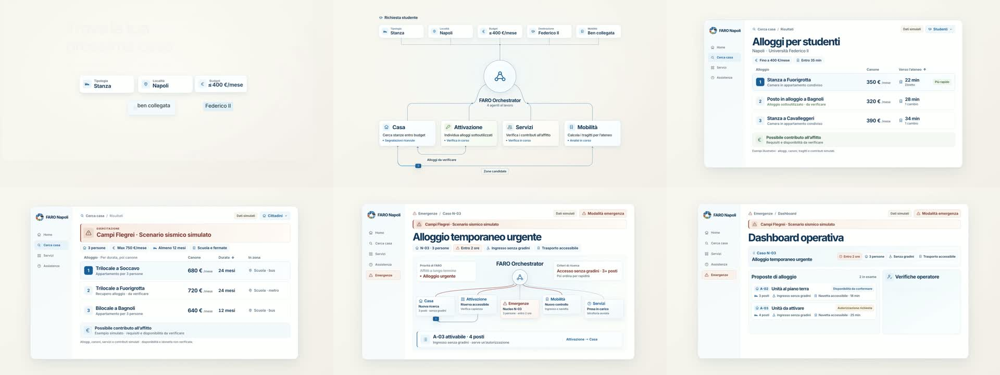

<div align="center">

# ✳ FARO Napoli
### Una casa. Una rete. Una città che vive.

Un concept di intelligenza artificiale multi-agente per connettere **casa, servizi e mobilità** a Napoli.

[Avvio locale](#avvio-locale) · [Guarda la demo](web-public/media/demo.mp4) · [Materiali originali](assets/slides/)


</div>



## Abitare significa appartenere

Trovare una casa significa anche raggiungere un’università, accedere ai servizi e vivere il territorio. FARO Napoli esplora una risposta coordinata: agenti specializzati che mettono in relazione esigenze abitative, possibilità di attivazione degli immobili, servizi e mobilità.

> **Progetto dimostrativo.** Le schermate e i video presentano dati simulati. Non è disponibile un servizio di ricerca immobiliare operativo; alloggi, canoni, contributi e tempi richiedono verifica.

## Quattro prospettive, una visione

| Area | Ruolo nel concept |
| :--- | :--- |
| **⌂ Casa** | Esplorare soluzioni in base a esigenze e budget. |
| **✧ Attivazione** | Individuare il potenziale degli alloggi sottoutilizzati, soggetto a verifica. |
| **◇ Servizi** | Collegare il percorso abitativo a servizi e contributi da verificare. |
| **↗ Mobilità** | Considerare collegamenti, tempi di viaggio e accessibilità. |

Un orchestratore rappresentato nella demo coordina queste prospettive. Gli scenari illustrativi includono studenti e necessità abitative temporanee.

## Avvio locale

Una pagina responsive in italiano, con palette crema, verde petrolio e terracotta, grafica orbitale in CSS, video integrato e navigazione tra visione e sistema. Realizzata con React, TypeScript e Vite. I font Google sono opzionali: sono previsti fallback locali.

```sh
npm install
npm run dev
```

Apri **http://localhost:5173** per la landing e **http://localhost:5173/#/app** per l’applicazione. La navigazione usa hash URL, compatibili con hosting statico senza regole di riscrittura. Per creare la versione di produzione esegui `npm run build`; `npm run preview` permette di verificarla localmente. Pubblica il contenuto di `dist/` sul tuo hosting statico.

## Dentro il repository

```text
src/
  main.tsx                  Bootstrap React
  App.tsx                   Selezione landing / applicazione
  landing/                  Sito di presentazione
    pages/                  LandingPage
    components/layout/      Header e footer
    components/sections/    Sezioni della pagina
    styles/                 Stili isolati dalla UI applicativa
  app/                      Shell e navigazione del prodotto
    Application.tsx         Selezione delle pagine
    routes.ts               Definizione delle voci di navigazione
    layout/                 Sidebar e layout condiviso
    pages/                  Dashboard
    styles/                 Stili dell’applicazione
  features/
    housing/                Ricerca dimostrativa
      components/           Schede degli alloggi
      data/                 Fixture simulate
      services/             Repository e filtri
      types/                Contratti di dominio
    activation/             Pagina iniziale del modulo
    services/               Pagina iniziale del modulo
    mobility/               Pagina iniziale del modulo
  shared/                   Componenti riutilizzabili e stili di base
  index.ts                  Entrypoint Remotion separato
web-public/media/           Asset della landing
public/                     Asset del film Remotion
assets/                     Materiali originali
vite.config.mts             Configurazione web
```

Le dipendenze in `package.json` includono React e Remotion per il lavoro audiovisivo. La landing usa il video già prodotto. `npm run studio` apre il progetto Remotion, separato dall’entrypoint web. Il nuovo scaffold è frontend-only: non include backend, autenticazione, database o agenti AI operativi. Il contratto `HousingRepository` separa la UI dalla sorgente dei dati, per consentire un futuro adapter HTTP. La ricerca casa usa fixture locali; attivazione, servizi e mobilità sono pagine iniziali con i prossimi passi esplicitati.

## Contribuire

Apri una issue per proporre miglioramenti alla presentazione, all’accessibilità o alla documentazione. Descrivi il problema e il risultato atteso; per modifiche visive includi un confronto prima/dopo.

## Materiali e diritti

I materiali originali sono inclusi per documentare il progetto. Non è stata definita una licenza di riutilizzo per il codice o gli asset: contatta i titolari prima di riutilizzarli.

---
<div align="center">Pensato per Napoli. A partire dalle persone.</div>
